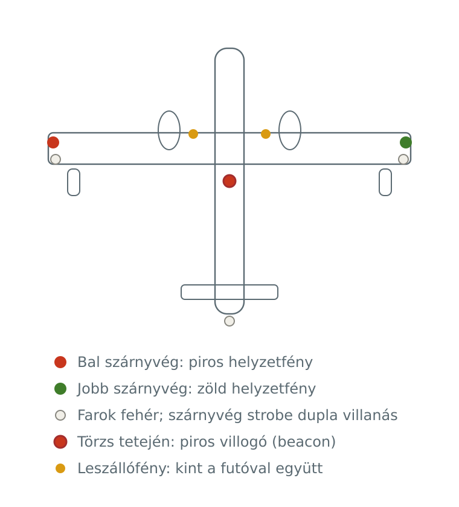
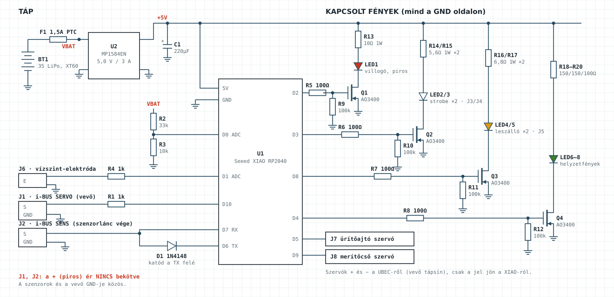
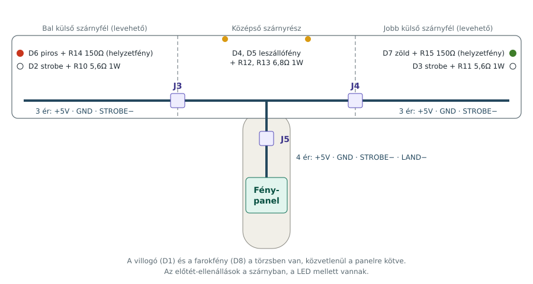
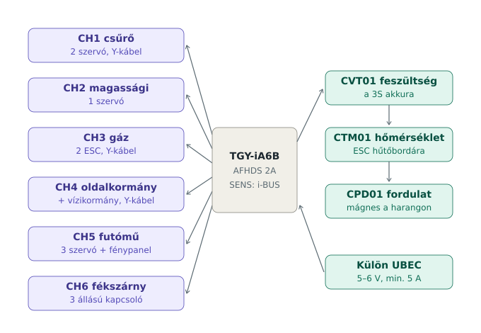
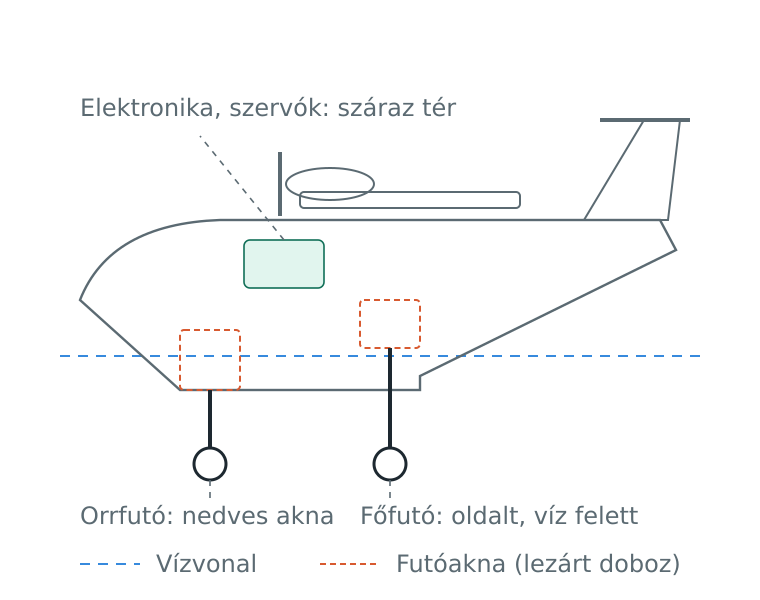

# CL-415 RC vízibombázó

Kétmotoros, kefe nélküli hajtású Canadair CL-415 RC modell XPS habból, behúzható futóművel és az igazi géphez hasonló jelzőfényekkel.

## Főbb adatok

| | |
|---|---|
| Fesztáv | 1800 mm |
| Szárnyfelület | kb. 40 dm² |
| Súlycél | víz nélkül kb. 2,0–2,2 kg; 500 ml vízzel kb. 2,78 kg |
| Anyag | 5 mm XPS padlóalátét, 3 mm rétegelt lemez, coroplast / üvegszövet a hajótest alján |
| Hajtás | 2× 2830 1000–1100 kV, 2× 40 A ESC, 2× 8×6 négytollú (CW + CCW), 3S LiPo |
| Rádió | Turnigy TGY-i10 adó, FlySky FS-iA10B vevő (10 csatorna), i-BUS telemetria (feszültség, hőmérséklet, fordulatszám) |
| Futómű | behúzható, vízálló szervókkal mozgatva |
| Fények és víz | helyzetfények, piros villogó, strobe, leszállófény; 500 ml-es víztartály merítőcsővel és ürítőajtóval; Seeed XIAO RP2040 vezérlő i-BUS-on |

## Dokumentáció

| Fájl | Tartalom |
|---|---|
| [docs/SZERELESI_UTMUTATO.md](docs/SZERELESI_UTMUTATO.md) | Szerelési útmutató: fénypanel, firmware, fények, futómű, hajtás, RC bekötés, vízzárás, festés, végellenőrzés |
| [docs/FEDELZETI_VEZERLO.md](docs/FEDELZETI_VEZERLO.md) | Fedélzeti vezérlő v2 (XIAO, i-BUS): működés, kapcsolási rajz, lábkiosztás, teszt, beállítás |
| [docs/ADO_TURNIGY_I10.md](docs/ADO_TURNIGY_I10.md) | Turnigy i10 adó és FS-iA10B vevő: kezelőszervek, funkciókiosztás, failsafe, telemetria |
| [docs/I10_FIRMWARE_ELEMZES.md](docs/I10_FIRMWARE_ELEMZES.md) | Az i10 gyári firmware-ének vizsgálata: mi módosítható, kockázatok, következő lépés |
| [docs/VIZTARTALY.md](docs/VIZTARTALY.md) | Víztartály: mennyi vizet bír a gép, tartály, ürítés, merítés |
| [docs/BOM.md](docs/BOM.md) | Alkatrészlista: fényvezérlő és teljes gép |
| [docs/TERVEK_ES_FORRASOK.md](docs/TERVEK_ES_FORRASOK.md) | A Paper-Replika terv letöltései és további források |
| [docs/elektronika.html](docs/elektronika.html) | Kapcsolási rajz és BOM egy oldalon (böngészőben megnyitható) |
| [docs/CL-415_Canadair_festes_matrica.pdf](docs/CL-415_Canadair_festes_matrica.pdf) | Canadair-stílusú festési séma és matricaív (A3) |
| [docs/img/](docs/img/) | Ábrák SVG-ben |
| [firmware/cl415_vezerlo/](firmware/cl415_vezerlo/cl415_vezerlo.ino) | Fedélzeti vezérlő firmware v2 (FS-iA10B, i-BUS) |
| [firmware/cl415_lights/](firmware/cl415_lights/cl415_lights.ino) | Régi fényvezérlő (v1, TGY-iA6B vevőhöz, CH5 PWM) |

## Ábrák

| | |
|---|---|
|  |  |
|  |  |

## A sárkányszerkezet terve

A modell a [Paper-Replika CL-415](https://paper-replika.com/index.php/rc-foam-project/bombardier-cl-415-rc-plane-part-1?showall=1) ingyenes terve alapján épül (Julius Perdana). A tervek a szerző oldaláról tölthetők le; ebben a repóban csak a hivatkozások szerepelnek.
