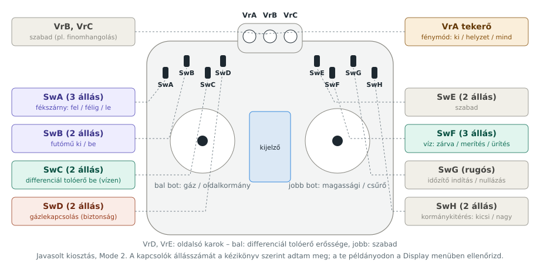

# Turnigy TGY-i10 adó és FS-iA10B vevő – kezelőszervek, funkciókiosztás, szoftver

A Turnigy TGY-i10 a FlySky FS-i10 Turnigy-márkás változata. AFHDS 2A protokollon kommunikál, így az FS-iA10B vevővel párosítva mind a **10 csatornát** és az i-BUS telemetriát is használja.

---

## 1. Kezelőszervek

| Kezelőszerv | Darab | Megjegyzés |
|---|---|---|
| Botok | 2 | kétcsapágyas, alapból Mode 2 (bal bot: gáz és oldalkormány) |
| Trimmek | 4 | digitális, középen magasabb hangú sípolás |
| Kapcsolók | 8 (SwA–SwH) | a kézikönyv szerint SwA és SwF 3 állású, SwG rugós (visszaugró), a többi 2 állású |
| Tekerők | 5 (VrA–VrE) | VrA, VrB, VrC felül; közülük három benyomva rögzíthető (elrejthető) |
| Oldalsó karok | 2 | a bal és jobb oldal élén; ez nagy valószínűséggel a **VrD (bal) és VrE (jobb)**, arányos (fokozatmentes) kar |
| Kijelző | 3,55" érintőképernyő | 240×400 képpont |
| Egyéb | | USB (frissítés), trainer csatlakozó, SD-kártya foglalat (SD 2.0, legalább 1 GB) |

**Saját példányod ellenőrzése:** a *Display* (szervókijelző) menüben minden kapcsolót és tekerőt végigmozgatva látod, melyik csatorna mozdul és hány állása van. A kézikönyvek az állásszámokban nem teljesen egységesek, ezért a kiosztás előtt ezt érdemes megnézni.

Az adó akkuja nálad a TGY-B1700 (3,7 V, 1700 mAh Li-ion polimer). A gyári kézikönyv 800 mAh-s akkuval számol, a tiéd tehát kb. kétszer annyi ideig bírja.

## 2. Szoftverfunkciók, amelyekre szükségünk lesz

Az i10 gyári menüjéből a projekthez ezeket használjuk:

| Menü | Mire jó nekünk |
|---|---|
| **Aux channels** (segédcsatornák) | bármelyik kapcsolót vagy tekerőt bármelyik csatornára rendelheted |
| **Airplane structure / Aileron** | két külön csűrőszervó, differenciált csűrő, flaperon |
| **Flap** | fékszárny állások egy 3 állású kapcsolón |
| **Linear / curve mix** (keverők) | differenciál tolóerő: oldalkormány → bal és jobb gáz |
| **Function delay / Channel delay** | szervólassítás: a futó és a fékszárny lassan, élethűen mozog |
| **Conditions** (repülési állapotok, max. 5) | pl. „Felszállás”, „Leszállás”, „Vízbombázás” külön beállításokkal |
| **Logic switches** | feltételek kombinálása, pl. differenciál tolóerő csak alapjárat közelében |
| **Throttle down / Throttle cut** | gázlekapcsolás biztonsági kapcsolóval |
| **Timers** | repülési idő mérése |
| **RX setup → Failsafe** | csatornánkénti failsafe |
| **Sensors** | a telemetria kijelzése és riasztásai (lásd 5. pont) |

## 3. Javasolt funkciókiosztás (10 csatorna)

| CH | Funkció | Kezelőszerv | Hová megy a vevőn |
|---|---|---|---|
| 1 | csűrő bal | jobb bot vízszintes | szervó |
| 2 | magassági kormány | jobb bot függőleges | szervó |
| 3 | gáz bal motor | bal bot függőleges | bal ESC |
| 4 | oldalkormány + vízikormány | bal bot vízszintes | 2 szervó, Y-kábel |
| 5 | futómű | SwB (2 állás) | főfutó- és orrfutószervó, Y-kábellel |
| 6 | fékszárny | SwA (3 állás): fel / félig / le | 2 szervó, Y-kábel |
| 7 | csűrő jobb | (csűrőkeverés) | szervó |
| 8 | gáz jobb motor | bal bot + differenciál keverés | jobb ESC |
| 9 | víz funkció | SwF (3 állás): alsó = töltőnyílás nyitva / közép = mindkettő zárva / felső = ürítőajtó nyitva | XIAO kezeli, két külön szervóval |
| 10 | fénymód | VrA tekerő: ki / helyzetfény / mind | XIAO kezeli (i-BUS-ról olvas) |

**Kiegészítő kapcsolók (nem kell nekik csatorna):**
- **SwC:** differenciál tolóerő be/ki. Vízen bekapcsolva az oldalkormány a két motort is fordítja; levegőben kikapcsolva.
- **SwD:** gázlekapcsolás. Mindig ezzel kezdd és fejezd be a repülést.
- **SwE:** szabad. Mind a 10 csatorna foglalt, ezért ehhez csak akkor rendelhetünk funkciót, ha az adón belül keverjük egy meglévő csatornára (pl. a fénymód tekerője mellé).
- **SwG (rugós):** időzítő indítás/nullázás.
- **SwH:** kormánykitérés kicsi/nagy (dual rate).
- **VrB, VrC:** szabadon maradnak finomhangolásra.
- **VrD (bal oldalsó kar):** a differenciál tolóerő erőssége. A keverő arányát erre a karra állítva vízen menet közben, a gázkar elengedése nélkül finomíthatod, mennyire fordítsák a motorok a gépet.
- **VrE (jobb oldalsó kar):** szabad. Később jó lehet például a fékszárny finom állítására.

**Az oldalsó karok azonosítása:** a *Display* menüben mozgasd meg a kart, és nézd meg, melyik Vr-érték változik. Ha a kar nem VrD/VrE-ként jelenik meg, a kiosztást ahhoz igazítjuk.

**Megjegyzés a második csűrőhöz:** az *Airplane structure* menüben kétcsűrős szárnyat kell választani. Az i10 ilyenkor maga dönti el, melyik csatornán adja ki a második csűrőt. Ha nem a CH7-et választja, a táblázatot ahhoz igazítjuk, nem fordítva.

### Miért kerül a víz és a fény a XIAO-hoz?

A részletek: [FEDELZETI_VEZERLO.md](FEDELZETI_VEZERLO.md).

A töltőnyílás és az ürítőajtó két külön szervóval működik, de egyetlen 3 állású kapcsolóról (CH9) kapják a parancsot. A XIAO dönti el, melyik szervót mozgatja: alsó állásban a töltőnyílás nyit, középen mindkettő zárva, felső állásban az ürítőajtó nyit. Alsóból felsőbe váltva a kapcsoló áthalad a középső álláson, így a két nyílás soha nincs egyszerre nyitva, és nem kell rá két csatorna.

**Csak az i10-zel, XIAO nélkül** ugyanez két csatornát igényelne: a SwF-et két csatornára kellene rendelni egy-egy görbekeverővel (*Curve mix*), amelyek közül az egyik csak az alsó, a másik csak a felső állásban mozdul. Mivel mind a 10 csatorna foglalt, ezt a XIAO végzi.

A fénymód (CH10) ugyanígy a XIAO-hoz fut; neki ehhez nem kell külön vezeték, az i-BUS-ról olvassa.

## 4. Failsafe beállítás (jelvesztéskor)

| CH | Failsafe érték |
|---|---|
| 3 és 8 (gázok) | alapjárat (motorok leállnak) |
| 1, 2, 4, 7 (kormányok) | középállás, enyhe magassági és oldalkormány a lassú körözéshez |
| 5 (futómű) | kiengedve |
| 6 (fékszárny) | félig |
| 9 (víz) | középállás (töltőnyílás és ürítőajtó zárva) |
| 10 (fény) | minden fény be (könnyebb megtalálni a gépet) |

A XIAO külön is figyeli a jelvesztést: ha az i-BUS-on nem jön adat, magától bezárja a tartályt és bekapcsolja a strobe-ot.

**Kipróbálás:** levett légcsavarral kapcsold ki az adót, és nézd meg, hogy minden a fenti helyzetbe áll-e. A kézikönyv szerint az adó 30 másodperc bekapcsolás után 5 másodpercenként küldi el a failsafe adatokat a vevőnek. Ha megfordítasz egy szervót, a failsafe-et újra be kell állítani.

## 5. Telemetria és saját adatok megjelenítése

Az i10 kezdőképernyőjén **legfeljebb 4 szenzor** jeleníthető meg egyszerre, a többi a *Sensors* menüben látszik. Riasztást (hangjelzést) a feszültség és a hőmérséklet szenzorokra lehet beállítani.

**Gyári szenzorok, amelyeket az i10 biztosan ismer:** fordulatszám (CPD01/02), hőmérséklet (CTM01), külső feszültség (CVT01), magasság (CAT01).

**Saját adatok a XIAO-ról:** a XIAO az i-BUS SENS láncon gyári szenzornak tud „álcázni” magát. Az i-BUS protokollban sok szenzortípus van (cellafeszültség, áram, üzemanyag-szint stb.), de **nem tudjuk biztosan, hogy az i10 ezek közül melyiket írja ki**. Ezért a fejlesztés első lépése egy teszt-firmware lesz: a XIAO sorban különböző típusokat küld, te pedig felírod, melyik jelenik meg a kijelzőn.

| Adat | Ha a megfelelő típus működik | Tartalékmegoldás |
|---|---|---|
| leggyengébb cella feszültsége | cellafeszültség típus | külső feszültség típus |
| tartály töltöttsége (%) | üzemanyag-szint típus | hőmérséklet típus, 0–100 értékkel |
| fénypanel hőmérséklete | hőmérséklet típus | – |
| ürítések száma | – | fordulatszám típus, darabszámként |

## 6. Firmware: mit lehet módosítani és mit nem

- **Az adó firmware-je zárt.** A gyártó oldaláról frissíthető USB-n, de nem ismert olyan nyílt forrású firmware (mint az OpenTX vagy EdgeTX), amely az i10-re készült. A kijelző elrendezését vagy a menüket nem tudjuk átírni.
- **Amit fejleszthetünk, az a gép oldala:** a XIAO firmware-je teljesen a miénk. Ott dől el, mit csinálnak a fények, a merítőcső és az ajtók, és milyen adatokat küldünk vissza az adó kijelzőjére.
- **Adatok a telefonra (későbbi ötlet):** ha a parton, közelről szeretnél részletes adatokat (pl. naplót a repülésről), a XIAO RP2040 helyett egy XIAO ESP32-S3 Bluetooth-on a telefonra küldheti őket. Repülés közben a hatótáv ehhez kevés, de a parton beállításhoz és visszanézéshez jó.

## Források

- [Turnigy TGY-i10 kézikönyv (manualmachine)](https://manualmachine.com/turnigy/tgyi10/20068122-instruction-manual)
- [FlySky FS-i10 kézikönyv (manuals.online)](https://manuals.online/fly-sky/remote-control/fs-i10/user-manual/1x67k)
- [FlySky FS-i10 gyorsindító (manuals.plus)](https://manuals.plus/fs-flysky/fs-i10-transmitter-and-receiver-manual.pdf)
- [DeviationTX fórum: AFHDS 2A és i-BUS szenzortípusok](https://www.deviationtx.com/forum/protocol-development/5251-flysky-afhds-2a-protocol-as-used-i10-i6-it4?start=580)
- [ArduPilot: i-BUS telemetria](https://ardupilot.org/plane/docs/common-ibus-telemetry.html)
