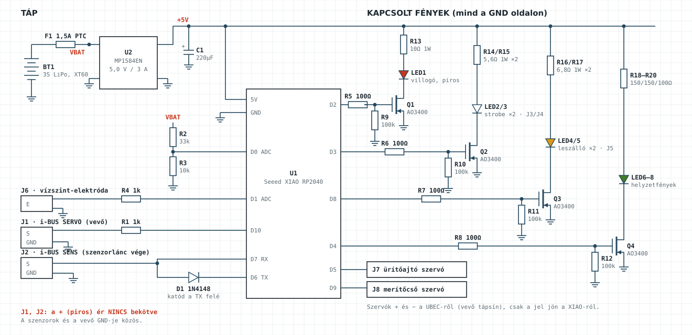

# Fedélzeti vezérlő v2 – fények, víz funkció, telemetria

Egyetlen Seeed XIAO RP2040 vezérli a fényeket és a víztartályt, és saját adatokat küld az i10 kijelzőjére. Az FS-iA10B vevő mindkét i-BUS portját használja.

- **i-BUS SERVO:** a XIAO egyetlen vezetéken látja mind a 10 csatornát.
- **i-BUS SENS:** a XIAO a szenzorlánc végén saját szenzorként válaszol a vevőnek.

Firmware: [`firmware/cl415_vezerlo/cl415_vezerlo.ino`](../firmware/cl415_vezerlo/cl415_vezerlo.ino). A régi, CH5-öt PWM-ként figyelő változat (`firmware/cl415_lights`) a TGY-iA6B vevőhöz készült; az FS-iA10B-hez már ez az új kell.

---

## 1. Mit csinál

### Fények

| Helyzet | Helyzetfény | Villogó (piros) | Strobe (fehér) | Leszállófény |
|---|---|---|---|---|
| Bekapcsolás, még nincs i-BUS adat | ég | lassan villog | ki | ki |
| Fénymód **ki** (VrA balra) | ki | ki | ki | ki |
| Fénymód **normál** (VrA középen) | ég | 1 Hz | dupla villanás | ég, ha a futó lent van **vagy** a fékszárny leszálló állásban (vízi leszálláshoz) |
| Fénymód **mind** (VrA jobbra) | ég | 1 Hz | dupla villanás | mindig ég |
| Ürítés közben | – | **gyorsan villog** | – | – |
| Jelvesztés (az i-BUS elhallgat) | ég | gyorsan villog | gyors villanások | ég |

A leszállófény lágyan, kb. 0,6 másodperc alatt kapcsol fel és le.

### Víz funkció (CH9, SwF 3 állású kapcsoló, két külön szervó)

| SwF állása | Töltőnyílás (merítő) szervó | Ürítőajtó szervó |
|---|---|---|
| **alsó** | nyitva; tele tartálynál magától zár | zárva |
| **középső** | zárva | zárva |
| **felső** | zárva | nyitva |
| jelvesztés | zárva | zárva |

Alsóból felsőbe váltva a kapcsoló áthalad a középső álláson, így a két nyílás soha nincs egyszerre nyitva. Ha a kapcsolón fordítva jön ki az alsó és a felső állás, a firmware elején `VIZ_KAPCSOLO_FORDITVA = true`, vagy az i10 *Reverse* menüjében fordítsd meg a CH9-et.

### Adatok az i10 kijelzőjén

| Szenzor | Mit mutat |
|---|---|
| 1 | az akku átlagos cellafeszültsége |
| 2 | a tartály töltöttsége % (500 ml = 100%) |
| 3 | a XIAO hőmérséklete (a fénypanelé) |
| 4 | az ürítések száma |

**A töltöttség becslés.** A firmware a merítés idejéből számolja (alapból 120 ml/s), és ürítéskor nullázza. Ha a tartály tetejére vízszint-elektródát szerelsz, az pontosan jelzi, hogy megtelt.

## 2. Kapcsolási rajz

### Lábkiosztás

| XIAO láb | Funkció | Bekötés |
|---|---|---|
| 5V | táp | a fénypanel 5 V-os sínje (MP1584EN) |
| GND | föld | közös a vevővel, a UBEC-kel és az akkuval |
| D0 | akkufeszültség mérés | 33 kΩ a VBAT-ról, 10 kΩ a GND-re |
| D1 | vízszint-elektróda (opcionális) | 1 kΩ soros ellenálláson át; a másik elektróda GND |
| D2 | villogó | Q1 gate (100 Ω soros, 100 kΩ lehúzó) |
| D3 | strobe | Q2 gate |
| D4 | helyzetfények | Q4 gate |
| D5 | ürítőajtó szervó | szervó jel |
| D6 (TX) | i-BUS SENS adás | 1N4148 diódán át, **katód a D6 felé** |
| D7 (RX) | i-BUS SENS vétel | közvetlenül a SENS buszra |
| D8 | leszállófény | Q3 gate (PWM a lágy kapcsoláshoz) |
| D9 | merítőcső szervó | szervó jel |
| D10 | i-BUS SERVO vétel | 1 kΩ soros ellenálláson át |

### Változás az első változathoz képest

- **A helyzetfények is kapcsolhatók** (Q4), hogy a fénymód „ki” állása mindent lekapcsoljon. Minden LED a GND oldalon kapcsolódik.
- **A szárnycsatlakozók ugyanannyi erűek maradnak, de a második ér GND helyett NAV− lett:**

| Csatlakozó | Erek |
|---|---|
| J3 bal külső szárny | 1: +5V · 2: NAV− · 3: STROBE− |
| J4 jobb külső szárny | 1: +5V · 2: NAV− · 3: STROBE− |
| J5 középső szárny ↔ törzs | 1: +5V · 2: NAV− · 3: STROBE− · 4: LAND− |

- A CH5 Y-kábel és a CH5 feszültségosztó elmarad; helyette a J1 (i-BUS SERVO) és a J2 (i-BUS SENS) csatlakozó jön.

### Szenzorlánc sorrendje

`vevő SENS → CVT01 → CTM01 → CPD01 → XIAO`

A gyári szenzorok az 1–3. címet kapják, a XIAO a 4–7. címen válaszol. Ha más számú gyári szenzort kötsz elé, a firmware elején a `KULSO_SZENZOROK` értékét kell átírni.

## 3. Mielőtt bekötöd: mérd meg az i-BUS jelszintet

A XIAO bemenete legfeljebb 3,3 V-ot visel el. Az FS-iA10B i-BUS jele általában 3,3 V-os, de érdemes ellenőrizni.

1. A vevőt párosítsd az adóval, és kapcsold be mindkettőt.
2. Multiméterrel mérd meg a SERVO port jelvezetéke és a GND közötti feszültséget.
3. **3,3 V vagy kevesebb:** a rajz szerinti 1 kΩ soros ellenállás elég.
4. **5 V körül:** a D10 elé tegyél 4,7 kΩ / 10 kΩ feszültségosztót (mint az első változatban a CH5-nél), és a SENS buszt ne kösd a XIAO-ra, amíg nem találunk rá szintillesztést.

## 4. Firmware feltöltése

1. Arduino IDE, **Raspberry Pi Pico/RP2040** csomag (Earle Philhower), alaplap: **Seeed XIAO RP2040**.
2. Nyisd meg a `cl415_vezerlo.ino` fájlt, és töltsd fel. Külön könyvtár nem kell, a `Servo` és a `SerialPIO` a csomag része.
3. Programozás közben a gép akkuja legyen lehúzva.

A firmware a 6.3.2-es RP2040 csomaggal hiba és figyelmeztetés nélkül lefordul.

### Beállítások a fájl elején

| Beállítás | Alapérték | Mire való |
|---|---|---|
| `TESZT_MOD` | false | szenzortípus-teszt (lásd 5. pont) |
| `KULSO_SZENZOROK` | 3 | a XIAO előtti gyári szenzorok száma |
| `CELLA_TIPUS`, `TARTALY_TIPUS` | cella, üzemanyag | a teszt eredménye szerint állítandó |
| `FUTO_LENT_HA_MAGAS` | true | ha a leszállófény fordítva reagál a futóra |
| `TARTALY_ML` | 500 | a tartály hasznos térfogata |
| `MERITES_ML_PER_S` | 120 | a becslés alapja; próbával pontosítsd |
| `VIZSZINT_ERZEKELO` | false | true, ha be van szerelve az elektróda |
| `AJTO_*`, `MERITO_*` | 1100 / 1900 µs | a két szervó végállásai |
| `VIZ_KAPCSOLO_FORDITVA` | false | ha az SwF alsó és felső állása fordítva hat |
| `AKKU_KALIB` | 1.000 | multiméterrel összevetve finomítható |

## 5. Szenzortípus-teszt az i10-en

Nem tudjuk biztosan, hogy az i10 mely i-BUS szenzortípusokat írja ki. Ezt egyszer ki kell próbálni:

1. A firmware elején állítsd a `TESZT_MOD` értékét `true`-ra, és töltsd fel.
2. Kapcsold be az adót és a gépet, majd nyisd meg az i10-en a **Sensors** menüt.
3. Ezeket kellene látnod:

| Típus | Elvárt érték |
|---|---|
| külső feszültség | 12,34 V |
| cellafeszültség | 4,12 V |
| üzemanyag | 55 % |
| hőmérséklet | 25,0 °C |
| fordulatszám | 1234 |

4. Írd fel, melyik jelent meg.
   - Ha a **cellafeszültség** nem: `CELLA_TIPUS = T_KULSO_FESZ`.
   - Ha az **üzemanyag** nem: `TARTALY_TIPUS = T_HOMERSEKLET` (ilyenkor a töltöttség 0–100 „fokként” látszik).
5. Állítsd vissza a `TESZT_MOD` értékét `false`-ra, és töltsd fel újra.

## 6. Adó beállítása ehhez a firmware-hez

| CH | Kezelőszerv | Megjegyzés |
|---|---|---|
| 5 | SwB | futómű; a leszállófény ezt figyeli |
| 6 | SwA (3 állás) | fékszárny; a felső állás (>1700 µs) a „leszálló” |
| 9 | SwF (3 állás) | alsó: töltőnyílás nyit / közép: mindkettő zárva / felső: ürítőajtó nyit |
| 10 | VrA tekerő | fénymód: ki / normál / mind |

**Failsafe:** CH9 = középállás (mindkettő zárva), CH10 = mind. A vevő jelvesztéskor ezeket az értékeket küldi az i-BUS-on, így a tartály bezárul és minden fény ég. Ha a vevő failsafe nélkül teljesen elhallgat, a XIAO 0,5 másodperc után magától is keresési módba vált.

## 7. Alkatrészek (a v1-hez képest)

| Változás | Alkatrész | Db |
|---|---|---|
| új | AO3400A MOSFET (Q4) + 100 Ω + 100 kΩ | 1 + 1 + 1 |
| új | 1N4148 dióda (SENS busz) | 1 |
| új | 1 kΩ ellenállás (R1 i-BUS SERVO, R4 elektróda) | 2 |
| új | 33 kΩ + 10 kΩ ellenállás (akkumérés) | 1 + 1 |
| új | szervókábel a vevő i-BUS SERVO és SENS portjához | 2 |
| új | rozsdamentes csavar vagy drót elektródának (opcionális) | 2 |
| elmarad | CH5 Y-kábel, 4,7 kΩ + 10 kΩ osztó | – |
