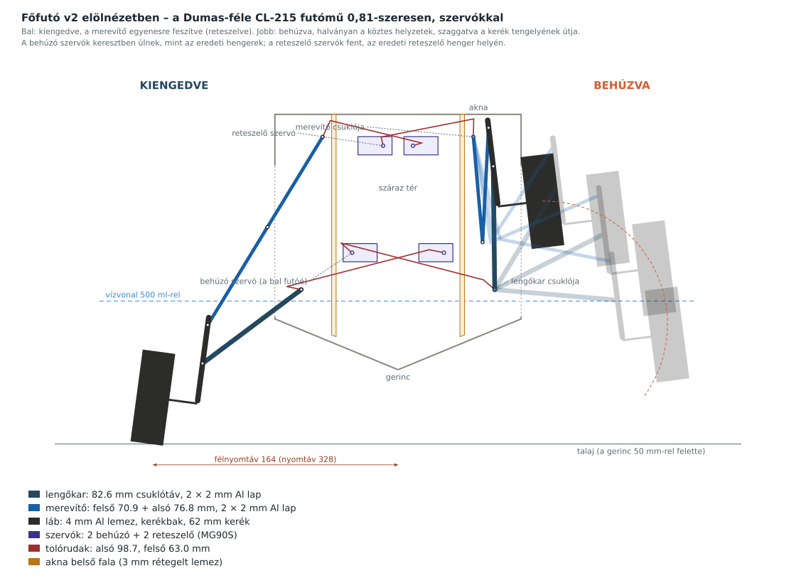
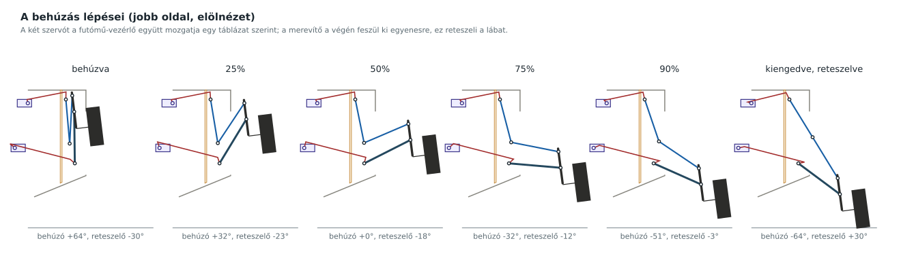
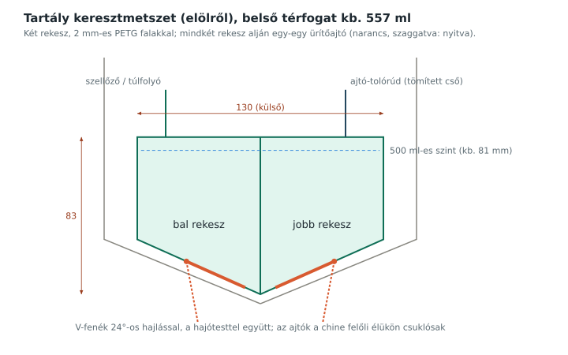
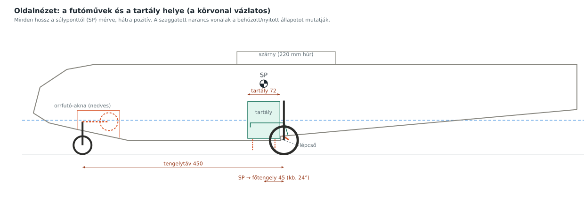
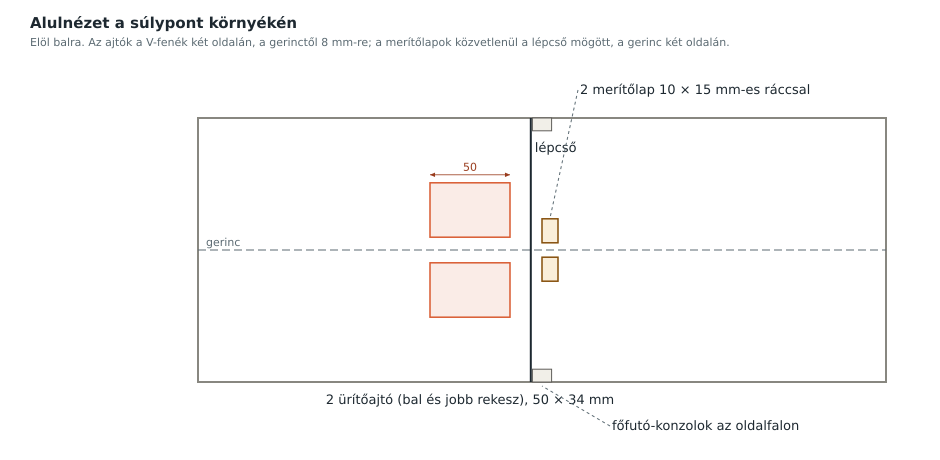
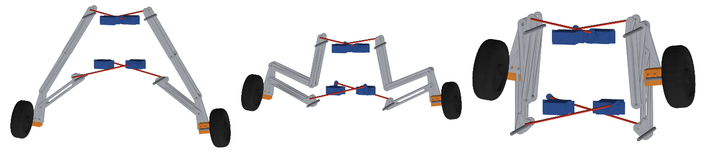

# Futómű és víztartály – méretezett terv

Ez a fejezet a behúzható futóművet és az 500 ml-es víztartályt írja le úgy, hogy SolidWorksben (vagy bármilyen CAD-ben) tovább lehessen modellezni:

- méretezett rajzok (`docs/img/`);
- a sík alkatrészek DXF-ben (`cad/dxf/`), 1:1 méretben, mm-ben;
- 3D alkatrészek és összeállítások STEP-ben (`cad/step/`), a nyomtatható részek STL-ben is;
- paraméterlista a SolidWorks egyenletkezelőjéhez (`cad/cl415_parameterek.txt`);
- a generáló programok a `cad/` mappában. Ha egy méret változik, ezekkel minden rajz, DXF, STEP és a vezérlő mozgástáblázata újra előállítható:
  - `futomu_kinematika.py`: a főfutó mozgásának számítása;
  - `gen_futomu_v2.py`: a főfutó rajzai, alkatrészei és összeállításai;
  - `gen_futomu_tartaly.py`: az oldal- és alulnézet, a tartály és az orrfutó;
  - `gen_step.py`: a kerekek, a csapágyak, az orrfutó és a tartály 3D modellje.

A törzs méretei a Paper-Replika terv formereiből vannak lemérve: belső szélesség 155 mm, V-fenék kb. 24°-os hajlással, a chine kb. 34 mm-rel a gerinc felett.

---

## 1. Koordináta-rendszer

Minden rajz és DXF ugyanazt használja, hogy a SolidWorks-összeállításban egyszerű legyen illeszteni.

| Tengely | Nullpont | Irány |
|---|---|---|
| x (oldalirány) | a törzs középsíkja | jobbra pozitív (elölnézetben) |
| y (függőleges) | a gerinc legalsó pontja | felfelé pozitív |
| hossz | a súlypont (SP) | hátrafelé pozitív |
| z (a STEP-ben) | a főfutó állomása (SP + 62 mm) | előre pozitív |

## 2. Főfutó (v2)

A főfutó Bernard Dumas CL-215 modelljének futóművén alapul (1:12,9-es terv, 1998). A rajzból kiolvastam a csuklópontokat és a két végállást, és 0,81-szeresen átméreteztem a mi 1:15,9-es gépünkre. Az eredeti pneumatikus hengerek helyén szervók vannak. Magát a DWG-t nem tettem fel a GitHubra, mert más szerző munkája.

### 2.1 Működés

Oldalanként négy mozgó rész van, mint az eredetin és az igazi gépen:

- **Lengőkar** (az eredeti „triangle”): a törzs alján, az akna belsejében forog. A végén hordja a lábat.
- **Láb a kerékkel:** két csuklópontja van, 26 mm-re egymástól. Az alsón a lengőkar fogja, a felsőn a merevítő.
- **Kétrészes merevítő:** a felső csuklótól a lábig fut, középen térddel. Kiengedve egyenesre feszül, ez reteszeli a lábat. Behúzáskor a térd lefelé összecsuklik.

A **behúzó szervó** a lengőkart forgatja, a **reteszelő szervó** a merevítő felső tagját. A kettő együtt határozza meg a láb helyzetét. Ezért a futómű-vezérlő (3. fejezet) egy táblázat szerint egyszerre mozgatja őket.

- **Behúzva** a láb az aknában áll, a kerék függőlegesen a törzs oldalán, a vízvonal felett. A kerék alja 82 mm-rel van a gerinc felett.
- **Kiengedve** a lábat a kifeszült merevítő tartja. A nyomtáv 328 mm, a gerinc 50 mm-rel van a talaj felett.

### 2.2 Fő méretek

| Méret | Érték |
|---|---|
| Lengőkar csuklója | x = 64,8, y = 53,7 mm |
| Lengőkar hossza (csuklótáv) | 82,6 mm |
| Lengőkar szöge behúzva / kiengedve | +90,7° / −36,8° (127,5°-os elfordulás) |
| Láb: alsó (P1) és felső (P2) csukló távolsága | 26 mm |
| Kerék tengelye a P1-hez képest | a láb mentén 27,1 mm-rel lejjebb, kifelé 30 mm |
| Merevítő felső csuklója | x = 50,5, y = 156 mm |
| Felső merevítő / alsó merevítő | 70,9 / 76,8 mm |
| Tengely behúzva | x = 96,8, y = 112,9 mm |
| Tengely kiengedve | x = 164,2, y = −18,7 mm |
| Nyomtáv | 328 mm (az eredeti 406 mm × 0,81) |
| Gerinc a talaj felett | 50 mm |
| Főkerék | 62 mm átmérő, 22 mm széles |

**Eltérések a pontos 0,81-szeres kicsinyítéstől.** A mi törzsünk alacsonyabb (171 mm) az eredeti átméretezett törzsénél (204 mm), ezért két méretet módosítani kellett:

- a láb két csuklója közti távolság 35,9 helyett 26 mm;
- a merevítő felső csuklója 181,6 helyett 156 mm magasan van.

A merevítő hosszát úgy számoltam ki, hogy kiengedve pontosan egyenes legyen, behúzva pedig a térd lefelé csukódjon, mint az eredetin.

### 2.3 Szervók és tolórudak

| | Behúzó (alsó) | Reteszelő (felső) |
|---|---|---|
| Hely (a jobb futóé) | x = −30,8, y = 78,4: a túloldalon, keresztben, mint az eredeti henger | x = −10, y = 150: fent, az eredeti reteszelő henger helyén |
| Szervókar | 10 mm | 6 mm |
| Kar a futón | a lengőkaron 10 mm, 48,5°-ra a kar irányától | a felső merevítőn 12 mm, a csuklón túl |
| Tolórúd | 98,7 mm | 63,0 mm |
| Szervó elfordulása | ±63,8° (párhuzamos forgattyú: a lengőkar ugyanannyit fordul) | ±30° (a merevítő kb. 26°-ot fordul) |

- Négy MG90S szervó kell: oldalanként egy behúzó és egy reteszelő. A két behúzó Y-kábellel ugyanazt a jelet kapja, ugyanígy a két reteszelő.
- A bal és a jobb oldali szervó tükrözve van beépítve. A jobb oldaliak teste hátul van, a karjuk elöl; a bal oldaliaké fordítva. Így ugyanaz a jel tükrözött mozgást ad.
- Mind a négy szervó a száraz térben, a középső formeren ül.
- A tolórudak a belső falon gumiharanggal tömített résen mennek át:
  - az alsók y = 64–70 mm-nél, a vízvonal felett;
  - a felsők y = 166 mm-nél.
- A tolórúd 1,5–2 mm-es acélhuzal Z-hajlítással, vagy M2-es menetes rúd villás véggel.

### 2.4 Akna és szerkezet

- Az akna oldalanként a belső fal (x = 41,5–44,5 mm) és a hajótest oldala között van. Elöl és hátul 3 mm-es rétegelt lemez fal zárja a futómű állomásától ±35 mm-re, vagyis a súlyponttól +27 és +97 mm-re.
- A lengőkar és a merevítő csapszegei (M3) az első és a hátsó aknafal között mennek át, távtartó csövekkel.
- **Az akna nedves, és oldalt nyitott**, mint az igazi gépen. A hajótest oldalán y = 35–137 mm és z = ±35 mm között ki kell vágni. Vízen állva az akna alja a vízvonalig (46 mm) vizet kap; kiemelkedéskor kifolyik. Az akna belső falát és a középső formert ezért epoxival le kell kenni.
- Rétegek z irányban a láb síkjától: láb (4 mm) – lengőkar-lapok (±4,5…6,5) – alsó merevítő (±7…9) – felső merevítő (±9,5…11,5) – tolórudak (±12).

### 2.5 Rugózás

Az eredeti lábban teleszkópos rugózás és ollós csukló van. Ebben a méretben a kerék tengelye csak 27 mm-re van az alsó csuklótól, így nem fér el benne értelmes rugóút. Ezért a láb merev, a leszállást a habkerék puhasága veszi fel. Ha mégis kell rugózás, a kerékbak gumibakos felfüggesztéssel átalakítható.

### 2.6 Alkatrészek

| Alkatrész | Anyag | Darab | Fájl |
|---|---|---|---|
| Lengőkar (két lap oldalanként) | 2 mm Al | 4 | `fo2_lengokar` |
| Felső merevítő karral | 2 mm Al | 4 | `fo2_merevito_felso` |
| Alsó merevítő | 2 mm Al | 4 | `fo2_merevito_also` |
| Láb | 4 mm Al | 2 | `fo2_lab` |
| Kerékbak (a kerék tengelye, M3 menettel) | PA/PETG nyomtatott vagy Al | 2 | `fo2_kerekbak` (csak STEP) |
| Akna belső fala | 3 mm rétegelt lemez | 2 (tükrözve) | `fo2_akna_belso_fal` |
| Akna első/hátsó fala | 3 mm rétegelt lemez | 4 | `fo2_akna_elso_hatso_fal` |
| Középső former a 4 szervóval | 3 mm rétegelt lemez | 1 | `fo2_kozepso_former` |
| Csapszegek | M3 csavar + önzáró anya + alátétek, távtartó csövek | 10 | – |
| Szervó | MG90S | 4 | – |

A DXF-ek a `cad/dxf/`, a STEP-ek a `cad/step/alkatreszek/` mappában vannak, azonos névvel. A `fo2_` kezdetű DXF-ekben minden vonal a 0-s rétegen van.

**Tömeg:** a fém alkatrészek kb. 80 g, a rétegelt lemez akna kb. 90 g, a 4 szervó 54 g. Kerekekkel és csapokkal együtt kb. 270 g. Ez kb. 150 g-mal több, mint az első, paralelogrammás változat, így 500 ml vízzel a gép kb. 2,93 kg, a szárnyterhelés kb. 73 g/dm².

## 3. Futómű-vezérlő

A két szervópárt egy második XIAO RP2040 mozgatja (`firmware/cl415_futomu/`). A fő XIAO lábai mind foglaltak, és így a futómű a fényektől és a víztől függetlenül működik.

| Láb | Bekötés |
|---|---|
| D7 | a vevő CH5 kimenete (PWM), 4,7 kΩ / 10 kΩ-os osztón át, mint a régi fénypanelnél |
| 5V, GND | külön 5 V-os, legalább 3 A-es BEC (a szervók is erről kapnak tápot); közös GND a vevővel |
| D0 | a két behúzó szervó (Y-kábel) |
| D1 | a két reteszelő szervó (Y-kábel) |
| D2 | orrfutó szervó |

- A teljes mozgás 4 másodperc. A szervók a `mozgas_tabla.h` 41 pontja között egyenletesen haladnak, így a merevítő csak a legvégén feszül ki.
- Jelvesztéskor (0,5 másodpercig nincs CH5 jel) kiengedi a futót.
- Bekapcsoláskor mozgás nélkül a kapcsoló szerinti állásba áll.
- **Beállítás az első próbánál, kerekek nélkül, lassan:**
  1. A `BEHUZO_IRANY` és a `RETESZ_IRANY` értékével fordítsd meg a szervók irányát, ha fordítva mennek.
  2. A szervókarokat a középállásban (1500 µs) szereld fel. Ekkor a lengőkar kb. 27°-ra áll vízszintestől, félúton.
  3. A `RETESZ_KI_TRIM` értékével állítsd be, hogy kiengedve a merevítő 2–3°-kal túlmenjen az egyenesen, és az ütközőn feküdjön.

## 4. Orrfutó

| Méret | Érték |
|---|---|
| Kerekek | 2× 40 mm (ikerkerék, mint az igazi gépen) |
| Behúzás | hátrafelé, kb. 90°-kal |
| Csukló | kb. 20 mm-rel a gerinc felett |
| Láb hossza | 69 mm (csuklótól tengelyig; a főfutóhoz igazítva, hogy a gép vízszintesen álljon) |
| Akna | kb. 100 × 50 × 45 mm, nedves akna (kifelé nyitott, befelé zárt) |
| Aknaajtó | 85 × 52 mm-es lap, a lábra ragasztva; behúzva lezárja az aknát |
| Tengelytáv (orr- és főfutó) | kb. 450 mm |
| Mozgatás | saját szervó a száraz térben, a futómű-vezérlő D2 lábáról |
| Kormányzás | nincs; a kerekek szabadon elfordulnak, rugó tartja őket egyenesben |

DXF: `orrfuto_lab.dxf`, `orrfuto_aknaajto.dxf`.

## 5. Víztartály

A tartály a két futóakna közé került. Ezért keskenyebb és magasabb lett, a térfogata nem változott.

| Méret | Érték |
|---|---|
| Külső szélesség | 81 mm (belső 77 mm); a futóaknák belső fala között 1 mm hézaggal |
| Hossz | 72 mm külső (68 mm belső) |
| Alja | V-alakú, 24°-os hajlással; pontosan a hajótest fenekére fekszik |
| Teteje | 124 mm-rel a gerinc felett |
| Térfogat | kb. 557 ml teljesen; az 500 ml-es szint kb. 111 mm-nél van |
| Rekeszek | 2 (hosszanti válaszfal középen), hogy fordulóban a víz ne zúduljon egy oldalra |
| Hely | középen a súlypont alatt, így tele és üresen sem mozdul a súlypont |
| Anyag | 2 mm PETG (3D-nyomtatott) vagy PET-lemez ragasztva, belül epoxival lekenve |

DXF: `tartaly_eleje_hatulja.dxf`, `tartaly_oldal.dxf`, `tartaly_valaszfal.dxf`, `tartaly_teto.dxf`, `tartaly_fenek.dxf` (ajtónyílással, 2 db tükrözve).

### 5.1 Ürítőajtók

- Rekeszenként egy ajtó a V-fenék két felén, 50 × 32 mm-es nyílással, a gerinctől 8 mm-re.
- Az ajtó a chine felőli hosszú élén csuklós, befelé, a gerinc felé nyílik lefelé.
- **Egy szervó nyitja mindkettőt**, felülről, tömített csövön átmenő tolórúddal. A szervó zárja is az ajtókat, nem rugó.
- Az ajtólap 52 × 34 mm-es (körben 1 mm átfedés), 1 mm PET, szilikon tömítőcsíkkal (`urito_ajto.dxf`).

### 5.2 Merítőlapok

Két csuklós lap, az igazi géphez hasonlóan:

- a **lépcső mögött**, a gerinc két oldalán, 10 × 15 mm-es ráccsal ellátott nyílással (`merito_lap.dxf`);
- az első élükön csuklósak, 25–30°-ot nyílnak a vízbe, és a víz sebessége rövid csatornán át felnyomja a vizet a tartályba;
- **egy szervó** mozgatja mindkettőt;
- becsült töltési sebesség 4–6 m/s siklásnál kb. 0,3–0,45 l/s, tehát 500 ml kb. 1,5 másodperc alatt jön össze. Ha túl gyors vagy túl lassú, a nyílás betéttel szűkíthető.

## 6. Helyek oldalnézetben

| Elem | Hely a súlyponttól |
|---|---|
| Tartály | −36 … +36 mm |
| Ürítőajtók | −25 … +25 mm |
| Lépcső | +38 mm |
| Merítőlapok | kb. +50 mm |
| Főfutó-aknák (első és hátsó fal) | +27 … +97 mm |
| Főfutó tengelye és a középső former | +62 mm |
| Orrfutó tengelye | kb. −388 mm |

A középső formeren a szervók teste legfeljebb 17 mm-re nyúlik előre, így 9 mm marad a tartály hátfaláig.

## 7. Szervók összesen

| Feladat | Darab | Vezérlés |
|---|---|---|
| Főfutó behúzó | 2 | futómű-vezérlő D0 (Y-kábel) |
| Főfutó reteszelő | 2 | futómű-vezérlő D1 (Y-kábel) |
| Orrfutó | 1 | futómű-vezérlő D2 |
| Ürítőajtók | 1 | fő XIAO D5 (CH9 felső állás) |
| Merítőlapok | 1 | fő XIAO D9 (CH9 alsó állás) |

Mind a hét szervó a száraz térben ül, ezért nem kell vízálló típus.

## 8. 3D modellek (STEP)

| Fájl | Tartalom |
|---|---|
| `cad/step/fofuto_kiengedve.step` | főfutó-összeállítás kiengedve: középső former, aknafalak, lengőkarok, merevítők, lábak, kerékbakok, kerekek csapágyakkal, csapszegek, 4 szervó karral, tolórudak |
| `cad/step/fofuto_felut.step` | ugyanez félúton |
| `cad/step/fofuto_behuzva.step` | ugyanez behúzva |
| `cad/step/orrfuto.step` | orrfutó-láb 2 kerékkel (kiengedve, a csukló az origóban) |
| `cad/step/tartaly.step` | tartály válaszfallal és ajtónyílásokkal, fedél, 2 ürítőajtó |
| `cad/step/alkatreszek/` | minden alkatrész külön STEP-ben; a tartály, a fedél, a merítőlap és a kerekek STL-ben is, 3D-nyomtatáshoz |

Megnyitás SolidWorksben: **File → Open**, fájltípus **STEP**. Az összeállítások összeállításként nyílnak meg, minden alkatrész külön, saját színnel. A koordináták az 1. pont szerintiek.

A szervó (`szervo_MG90S_egyszerusitett.step`) és a kerekek egyszerűsített modellek. A kerekek:
- főkerék: 62 × 22 mm, mindkét oldalon 8 mm-es, 4 mm mély csapágyfészekkel (693);
- orrkerék: 40 × 15 mm, 6 mm-es, 2,5 mm mély fészekkel (MR63).

Ha kész kereket veszel, a modellt a megvett kerék méreteihez igazítsd.

## 9. SolidWorks-ben

1. **Paraméterek:** Eszközök → Egyenletek → Importálás, és válaszd a `cad/cl415_parameterek.txt` fájlt. A főfutó v2 méretei `fo2_` kezdetű globális változók.
2. **Sík alkatrészek:** Fájl → Megnyitás → DXF → „Importálás új alkatrészbe vázlatként”, mértékegység mm. A vázlatból kihúzással (Extrude) lesz alkatrész a 2.6 táblázat szerinti vastagsággal. Egyszerűbb, ha rögtön a STEP-et nyitod meg.
3. **A mozgás kipróbálása:** a `fofuto_felut.step` összeállításban a csapszegekre tegyél **Concentric** kényszert.
   - A mechanizmusnak két szabadságfoka van, ezért két szöget kell rögzíteni: a lengőkarét és a felső merevítőét.
   - A két végállás: lengőkar +90,7° / −36,8°; felső merevítő −85° / −58,6° (a vízszintestől, a térd felé mérve).

> A rajzok a Paper-Replika terv lemért formereihez készültek. Mielőtt alkatrészt vágsz, mérd le a saját megépített törzsedet, különösen a chine magasságát, az oldalfal helyét és a törzs magasságát a szárny alatt. Ha eltér, írd át a `futomu_kinematika.py` elején, és futtasd újra a generálókat.
