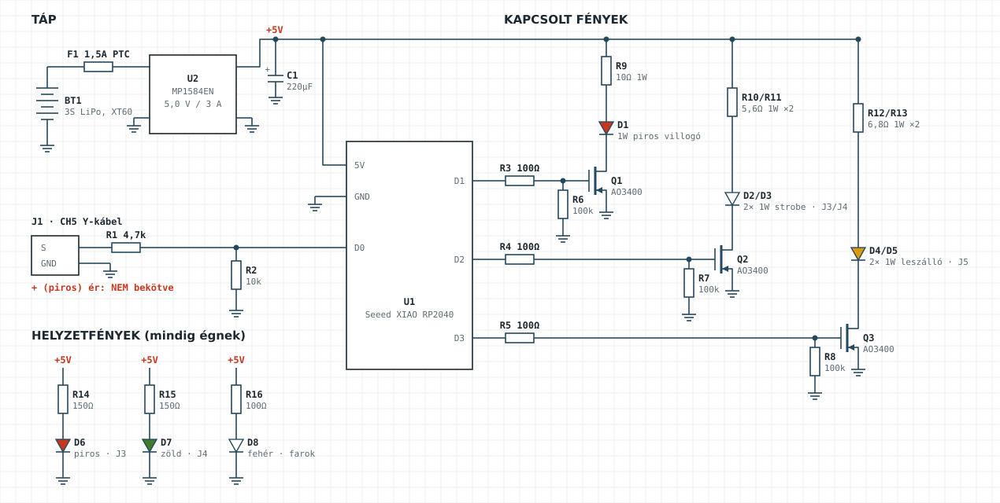
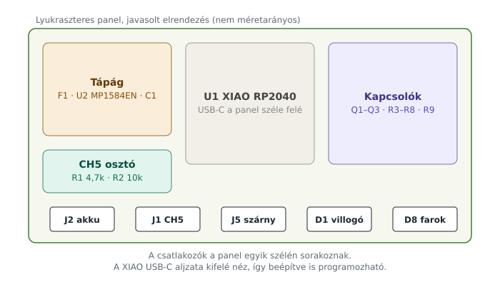
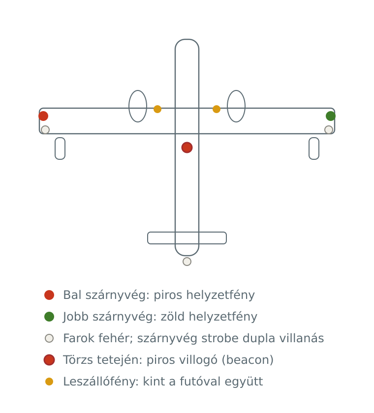
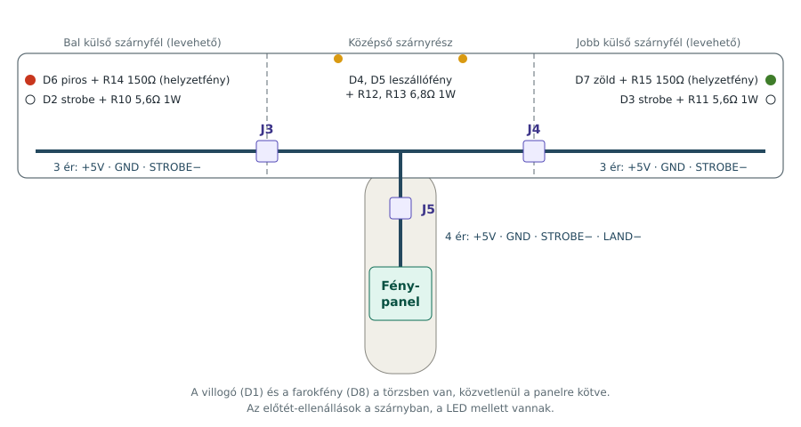
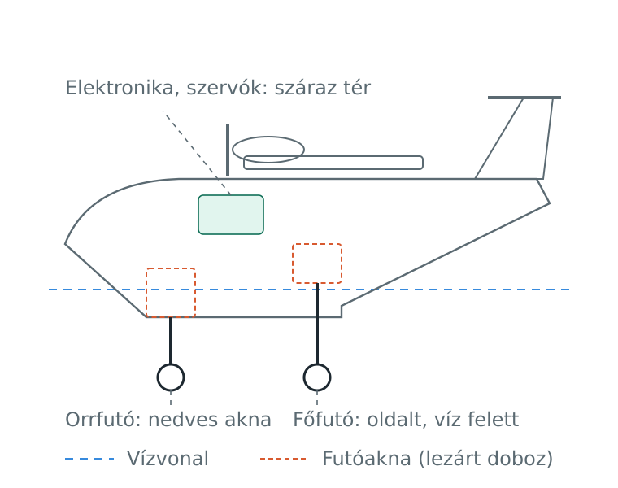
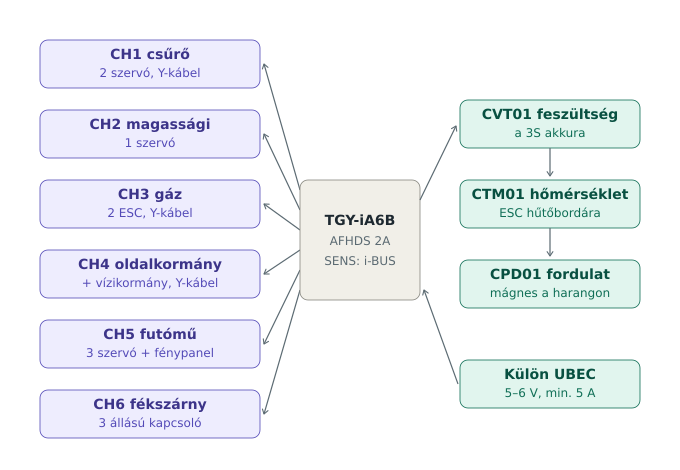

# CL-415 – Szerelési útmutató

Elektronika, futómű és jelzőfények beépítése a 180 cm-es, XPS habból épülő Canadair CL-415 RC modellbe.

A sárkányszerkezet (törzs, szárny, vezérsíkok, úszók) a [Paper-Replika CL-415](TERVEK_ES_FORRASOK.md) terve és videói szerint épül. Ez az útmutató azt írja le, ami ahhoz képest új vagy eltérő: a behúzható futómű, a vízzárás, a rádió bekötése és a jelzőfények.

Az alkatrészlista: [BOM.md](BOM.md). A fényvezérlő firmware-je: [`firmware/cl415_lights`](../firmware/cl415_lights/cl415_lights.ino).

---

## Tartalom

1. [Biztonság](#1-biztonság)
2. [Szerszámok](#2-szerszámok)
3. [Anyag és ragasztás XPS-hez](#3-anyag-és-ragasztás-xps-hez)
4. [A fénypanel megépítése](#4-a-fénypanel-megépítése)
5. [Firmware feltöltése és asztali teszt](#5-firmware-feltöltése-és-asztali-teszt)
6. [Fények beépítése a szárnyba és a törzsbe](#6-fények-beépítése-a-szárnyba-és-a-törzsbe)
7. [Futómű és futóaknák](#7-futómű-és-futóaknák)
8. [Hajtás](#8-hajtás)
9. [RC bekötés és telemetria](#9-rc-bekötés-és-telemetria)
10. [Adó beállítása](#10-adó-beállítása)
11. [Vízzárás, úszáspróba és festés](#11-vízzárás-és-úszáspróba)
12. [Végellenőrzés repülés előtt](#12-végellenőrzés-repülés-előtt)

---

## 1. Biztonság

- Minden beállítás és teszt **levett légcsavarral** történjen.
- A LiPo akkut csak felügyelet mellett, LiPo-tasakban töltsd.
- A fénypanel **programozásakor a gép akkuja legyen lehúzva**: a XIAO 5V lába közvetlenül az USB-tápra csatlakozik, a két forrás összeütközhet.
- Az MP1584EN step-down kimenetét **mindig a többi alkatrész nélkül** állítsd be (lásd 4.2).

## 2. Szerszámok

- Pákás forrasztóállomás, vékony (0,5–0,8 mm) forrasztóón, folyasztószer
- Multiméter
- Éles sniccer (új penge minden nagyobb szabásnál), fémvonalzó
- Csiszolóblokk 120–240-es papírral
- Ragasztópisztoly (alacsony hőfokú)
- Hőlégfúvó vagy öngyújtó a zsugorcsőhöz
- Csipesz, oldalcsípő fogó, blankoló

## 3. Anyag és ragasztás XPS-hez

Az XPS (extrudált polisztirol) oldószerre olvad.

| Használható | Tilos |
|---|---|
| UHU Por | sima pillanatragasztó (CA) |
| hab-barát CA + aktivátor | poliészter gyanta |
| 5 perces és laminálóepoxi | spray-festék, oldószeres festék és lakk |
| alacsony hőfokú ragasztópisztoly | aceton, hígító |
| vízbázisú akrilfesték és lakk | |

A hajótest aljára és a lépcsőre PP hullámlemez (coroplast) vagy üvegszövet + epoxi kerül, kopás és víz ellen.

---

## 4. A fénypanel megépítése

> **Frissítés:** az FS-iA10B vevőhöz a fedélzeti vezérlő **v2** változata tartozik (i-BUS, víz funkció, telemetria, kapcsolható helyzetfények). Kapcsolási rajz, lábkiosztás és firmware: [FEDELZETI_VEZERLO.md](FEDELZETI_VEZERLO.md). Az ebben a fejezetben és az 5–6. fejezetben leírt építési lépések (step-down beállítás, MOSFET-ek, LED-ek hűtése, vízzárás) változatlanul érvényesek; a lábkiosztás és a szárnycsatlakozók erezése a v2 szerint értendő.

### 4.1 Elrendezés

Lyukraszteres panelre építsd (kb. 30×50 mm vagy kicsit nagyobb). A csatlakozók egy szélen sorakozzanak, a XIAO USB-C aljzata kifelé nézzen, így a panel beépítve is programozható.

### 4.2 Step-down beállítása (ezzel kezdd)

1. Forraszd az F1 PTC biztosítót az akku + ágába, és kösd rá az MP1584EN bemenetére.
2. Kösd a modult egy 3S akkura **semmi mással a kimenetén**.
3. Multiméterrel mérd a kimenetet, és a modul potméterével állítsd **5,0 V**-ra.
4. Csepp lakkal vagy forró ragasztóval rögzítsd a potmétert, hogy rezgésre ne álljon el.

### 4.3 Beültetési sorrend

1. **Tápág:** U2 modul, C1 220 µF (polaritás!) az 5 V-os sínre.
2. **MOSFET-ek:** a Q1–Q3 AO3400 SOT-23 tokú. Forraszd őket SOT-23 → DIP adapterre, úgy könnyebb lyukraszterre ültetni.
3. **Gate-ellenállások:** mindegyik MOSFET gate-jébe soros R3–R5 100 Ω, és gate-től GND-re R6–R8 100 kΩ lehúzó. A lehúzó gondoskodik róla, hogy a XIAO indulásáig ne villanjon fel semmi.
4. **R9 10 Ω 1 W** a villogó (D1) ágában, a panelen.
5. **CH5 osztó:** R1 4,7 kΩ sorosan a J1 jelérintkezőtől, R2 10 kΩ a D0 lábtól GND-re. Az RP2040 bemenete nem viseli el az 5 V-ot; az osztó az 5 V-os jelet kb. 3,4 V-ra viszi le.
6. **XIAO:** tüskesor nélkül, rövid vezetékekkel vagy közvetlenül a forrasztási pontokra.
   - 5V láb → +5V sín
   - GND → közös GND
   - D0 → osztó középpontja
   - D1 → R3 (villogó), D2 → R4 (strobe), D3 → R5 (leszállófény)
7. **Csatlakozók:** J2 akku, J1 CH5, J5 szárny (4 pólusú JST-PH), D1 villogó, D8 farokfény (2 pólusú JST-PH).

> **J1 bekötése:** a CH5 Y-kábelből **csak a jel (sárga/fehér) és a GND (barna/fekete) ér** megy a panelre. A piros (+) eret húzd ki a csatlakozóházból és szigeteld le. A vevő UBEC-je és a panel step-downja nem köthető össze.

### 4.4 Ellenőrzés bekapcsolás előtt

- Multiméterrel ellenőrizd, hogy a +5V és a GND között nincs zárlat.
- Ellenőrizd a C1 polaritását és a MOSFET-ek lábkiosztását (G, S, D).

---

## 5. Firmware feltöltése és asztali teszt

### 5.1 Arduino IDE

1. *Fájl → Beállítások → További alaplapkezelő URL-ek*: add hozzá az Earle Philhower-féle RP2040 csomagot (`https://github.com/earlephilhower/arduino-pico/releases/download/global/package_rp2040_index.json`).
2. *Eszközök → Alaplap → Alaplapkezelő*: telepítsd a **Raspberry Pi Pico/RP2040** csomagot.
3. Alaplapnak válaszd a **Seeed XIAO RP2040**-et.
4. Nyisd meg a `firmware/cl415_lights/cl415_lights.ino` fájlt.
5. Ha a gép nem ismeri fel a XIAO-t: tartsd lenyomva a **B** gombot, és közben dugd be az USB-t.
6. Töltsd fel.

### 5.2 Asztali teszt

1. Kösd a LED-eket ideiglenesen, a szárny nélkül (ellenállásokkal!).
2. Húzd ki az USB-t, és tápláld a panelt a 3S akkuról.
3. Ellenőrizd:
   - a helyzetfények folyamatosan égnek;
   - a piros villogó másodpercenként villan;
   - a strobe 1,2 másodpercenként duplán villan.
4. Kösd a J1-et a vevő CH5 kimenetére (Y-kábelen), kapcsold be az adót.
5. A futómű kapcsolóját átváltva a leszállófény lágyan fel- és lekapcsol.

Ha a leszállófény fordítva működik (behúzott futónál ég), a kódban írd a `GEAR_DOWN_IS_HIGH` értékét `false`-ra, vagy az adón fordítsd meg a CH5 irányát.

---

## 6. Fények beépítése a szárnyba és a törzsbe

### 6.1 Elhelyezés

| Fény | Hely | Szín | Működés |
|---|---|---|---|
| D6 | bal szárnyvég | piros | folyamatosan ég |
| D7 | jobb szárnyvég | zöld | folyamatosan ég |
| D8 | farok | fehér | folyamatosan ég |
| D2, D3 | szárnyvégek, a helyzetfény mögött | fehér | strobe, dupla villanás |
| D1 | törzs teteje, a szárny mögött | piros | villogó, 1 Hz |
| D4, D5 | középső szárnyrész belépőéle, a gondolák mellett | fehér | ég, amikor a futó kint van |

### 6.2 Kábelezés

Az előtét-ellenállások a szárnyba kerülnek, közvetlenül a LED mellé. Így a levehető szárnyrészeken kevés eret kell átvinni.

| Csatlakozó | Hol | Erek |
|---|---|---|
| J3 | bal külső szárnyfél | 1: +5V · 2: GND · 3: STROBE− |
| J4 | jobb külső szárnyfél | 1: +5V · 2: GND · 3: STROBE− |
| J5 | középső szárny ↔ törzs | 1: +5V · 2: GND · 3: STROBE− · 4: LAND− |

- **Helyzetfény a szárnyvégen:** +5V → R14/R15 150 Ω → LED anód; katód → GND.
- **Strobe a szárnyvégen:** +5V → R10/R11 5,6 Ω 1 W → LED anód; katód → STROBE− (Q2 drain).
- **Leszállófény:** +5V → R12/R13 6,8 Ω 1 W → LED anód; katód → LAND− (Q3 drain).

A vezetékeket a szárny belsejében, a bordák között vezesd. Az XPS-be forró ragasztóval rögzített vékony műanyag csőbe húzva később cserélhetők.

### 6.3 Az 1 W-os LED-ek

- Mind alu csillagpanelen legyen.
- A leszállófény folyamatosan ég, ezért a csillagot ragaszd egy kis alulemezre (pl. 20×20 mm), amely elvezeti a hőt. Közvetlenül XPS-re ne ragaszd: a hab hőszigetel, a LED túlmelegszik.
- Az 1 W-os ellenállások is melegszenek: ne érjenek közvetlenül a habhoz, zsugorcsőben, kis távolságra legyenek.

### 6.4 Vízzárás

- A szárnyvégi LED-eket UV-ragasztóval vagy átlátszó epoxival öntsd ki.
- A JST csatlakozókat összedugva csavard körbe szigetelőszalaggal, vagy tegyél rájuk zsugorcsövet.
- A fénypanelt tedd zsugorcsőbe, és a törzs száraz terében rögzítsd tépőzárral.

---

## 7. Futómű és futóaknák

A Paper-Replika terv levehető fix futót használ. A behúzható futóhoz a törzset ennek megfelelően kell kialakítani.

### 7.1 Orrfutó-akna (nedves akna)

1. A hajótest alján, az orrfutó helyén alakíts ki egy XPS dobozt, amely **kifelé nyitott, a törzs belseje felé teljesen zárt**.
2. A doboz belsejét vond be vékony üvegszövettel és epoxival.
3. A víz be- és kifolyik az aknán, de a törzsbe nem jut.

### 7.2 Orrfutó rögzítése

Az eredeti terven az orrfutó kiugrott a helyéből. Ezért:

1. Vágj egy 3 mm-es rétegelt lemez talpat, amely két former között átér.
2. Epoxival ragaszd be a két formerhez és az akna tetejéhez.
3. A futószárat M3 csavarokkal, önzáró anyával fogd a talphoz.

### 7.3 Főfutók

- A törzs oldalán, **a vízvonal felett** kapnak helyet, ahogy az igazi gépen is.
- Az aknájuk itt is zárt doboz, belül epoxival.

### 7.4 Mozgatás szervóval

Az elektromos behúzó egységek nem vízállóak, ezért a futókat **vízálló szervók** mozgatják a száraz térből.

1. A szervó a száraz térben, az akna fölött vagy mellett ül.
2. A tolórúd zsírozott sárgaréz csövön át megy be az aknába.
3. A cső és az aknafal közötti rést szilikonnal töltsd ki.
4. A három futószervó a CH5-re kötött elosztóról kap jelet (lásd 9. pont).

A szervók lassabb mozgatásához használhatod az adó szervósebesség-állítását, ha a rádiód kínál ilyet.

### 7.5 Futószárak és kerekek

- Futószár: 3 mm-es rugóacél drót, hajlítva.
- Főkerék 45–55 mm, orrkerék 35–45 mm, könnyű habkerék.
- A kerékagyakat rögzítőgyűrűvel vagy forrasztott alátéttel biztosítsd.

---

## 8. Hajtás

1. **Motorok:** 2830 méret, 1000–1100 kV, a motortartókat 3 mm-es rétegelt lemezből készítsd, epoxival ragaszd a gondolába.
2. **ESC-k:** 2× 40 A. A BEC piros erét mindkettőnél szakítsd meg (a vevő tápját a külön UBEC adja). A két ESC egy Y-kábelen a CH3-ra kerül.
3. **Forgásirány:** a két motor ellentétes irányba forogjon. Ha egy motor rossz irányba forog, cserélj meg két motorvezetéket.
4. **Légcsavarok:** 8×6 négytollú, egy CW és egy CCW. A légcsavar feliratos oldala előre néz, és a lapát vastagabb belépőéle a forgás irányába mutasson.
5. **ESC kalibrálás:** a két ESC-t együtt, a Y-kábelen kalibráld az ESC leírása szerint (jellemzően teljes gáz → akku rá → hangjelzés → gáz le).
6. **Szigetelés:** a motor alatt a hab kapjon vékony rétegelt lemez vagy alu hőpajzsot.

A végleges légcsavarméretet wattmérővel ellenőrizd: teljes gáznál az áram ne lépje túl az ESC terhelhetőségének 80%-át.

---

## 9. RC bekötés és telemetria

> **Frissítés:** a vevő FS-iA10B-re cserélődik (10 csatorna, i-BUS). Az új funkciókiosztás és a failsafe: [ADO_TURNIGY_I10.md](ADO_TURNIGY_I10.md). Az alábbi táblázat a régi, 6 csatornás TGY-iA6B vevőre szól; a fényvezérlő i-BUS-os változata után ezt a fejezetet is átírjuk.

| Csatorna | Funkció | Bekötés |
|---|---|---|
| CH1 | csűrő | 2 szervó, Y-kábel |
| CH2 | magassági kormány | 1 szervó |
| CH3 | gáz | 2 ESC, Y-kábel |
| CH4 | oldalkormány | oldalkormány + vízikormány, Y-kábel |
| CH5 | futómű | 3 futószervó + fénypanel jele, elosztóval |
| CH6 | fékszárny | 2 szervó, Y-kábel |
| B/VCC | táp | külön UBEC, 5–6 V, min. 5 A |
| SENS (i-BUS) | telemetria | CVT01 → CTM01 → CPD01 láncban |

### 9.1 Tápellátás

- A vevő és a szervók a **külön UBEC**-ről kapnak tápot (B/VCC).
- A TGY-iA6B 4,0–6,5 V-ot visel el; az UBEC-et 5–6 V-ra állítsd.
- A vevő, az UBEC és a fénypanel GND-je legyen közös.

### 9.2 Telemetria

- **CVT01 feszültségszenzor:** a 3S akku + és − pontjára.
- **CTM01 hőmérsékletszenzor:** az egyik ESC hűtőbordájára, hőálló szalaggal.
- **CPD01 mágneses fordulatszám-szenzor:** a mágnes a motor forgó harangjára, a szenzor álló részre, 1–3 mm-re tőle.
- A szenzorok egymás után fűzve mennek a vevő SENS portjára, és az adó kijelzőjén jelennek meg.

---

## 10. Adó beállítása

1. Hozz létre új modellt (repülőgép), és párosítsd a vevőt.
2. **CH5** egy kétállású kapcsolóra kerüljön (futómű).
3. **CH6** egy háromállású kapcsolóra kerüljön (fékszárny: fent, közép, leszálló).
4. Állítsd be a **failsafe**-et: jelvesztéskor a gáz menjen alapjáratra, a kormányok középre.
5. Ellenőrizd a kormánykitérések irányát (a terv ajánlott kitéréseivel), és szükség esetén fordítsd meg a csatornákat.
6. Ellenőrizd, hogy a telemetriaértékek (feszültség, hőmérséklet, fordulatszám) megjelennek a kijelzőn.

---

## 11. Vízzárás és úszáspróba

1. A hajótest alját és az úszókat zárd le: coroplast vagy üvegszövet + epoxi, majd vízbázisú lakk.
2. A fedél alá tegyél habszivacs-tömítést, és rögzítsd szalaggal vagy mágnesekkel.
3. **Kádpróba:** az akkut és az elektronikát vedd ki, helyettük tegyél be azonos tömegű nehezéket. Úsztasd a gépet 10 percig, majd ellenőrizd, hogy a törzsben nincs-e víz.
4. Ellenőrizd a vízvonalat: a főfutó-aknák és a száraz tér legyenek felette.

### 11.1 Festés és matricák

A Canadair-stílusú sárga–piros festési séma és a matricaív: [CL-415_Canadair_festes_matrica.pdf](CL-415_Canadair_festes_matrica.pdf) (A3, 100%-os nyomtatás).

1. Vízbázisú alapozó, majd sárga alapszín 2–3 vékony rétegben. Spray és oldószeres festék tilos, mert oldja az XPS-t.
2. Maszkolás papírszalaggal, majd a piros felületek (vezérsík felső harmada, szárnyvégek, úszók, gondolaorrok), végül a fekete tükröződésgátló mező.
3. Vinyl matricák felrakása, majd vízbázisú lakk az egészre. A lakk a matricákat is védi a víztől.

---

## 12. Végellenőrzés repülés előtt

- [ ] Súlypont a Paper-Replika terv szerint
- [ ] Kormánykitérések iránya és mértéke rendben
- [ ] Failsafe beállítva és kipróbálva (adó kikapcsolásával, levett légcsavarral)
- [ ] Mindkét motor jó irányba forog, a légcsavarok jó oldalukkal előre
- [ ] Futómű kint és bent is reteszelődik, a szervók nem akadnak
- [ ] Leszállófény a futóval együtt kapcsol
- [ ] Helyzetfények, villogó, strobe működik
- [ ] Telemetria látszik az adón
- [ ] Kádpróba után a törzs száraz
- [ ] Az akku feltöltve és rögzítve

Az első repüléseket földről, nyugodt időben végezd. A vízről való felszállást csak azután próbáld, hogy a gép földön jól repül és a vízzárás bevált.
