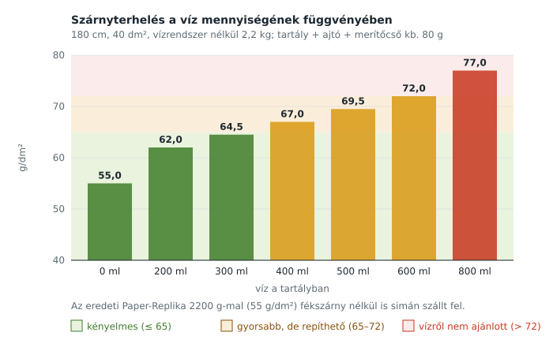
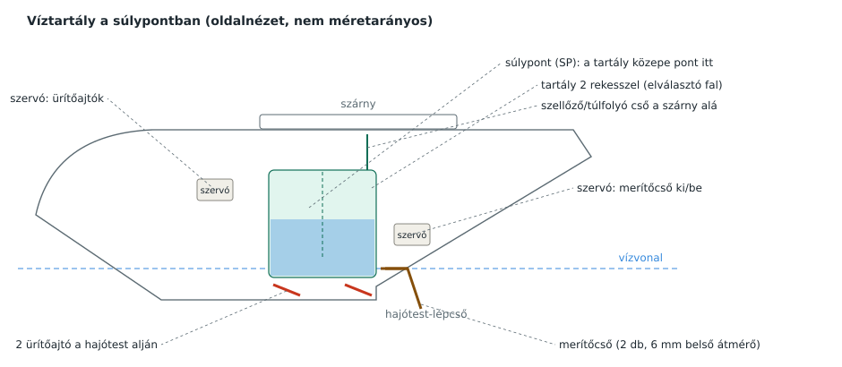

# Víztartály – mennyi vizet bír el a gép?

Röviden: **400 ml biztonságosan, 500 ml jó körülmények között**, 600 ml felett vízről nem ajánlott felszállni.

> **A méretezett terv:** [FUTOMU_ES_TARTALY.md](FUTOMU_ES_TARTALY.md) (130 × 72 mm-es, V-fenekű, kétrekeszes tartály, kb. 557 ml; merítőlapok a merítőcsövek helyett). Az alábbi 4. pont az első, előzetes ötleteket írja le.

> **Döntés: 500 ml-es tartállyal számolunk.** A gép 500 ml vízzel kb. 2,78 kg, a szárnyterhelés 69,5 g/dm². A kipróbálás lépcsőzetes marad (3. pont), az 500 ml az utolsó lépcső.

---

## 1. Miből számoltam

| Adat | Érték |
|---|---|
| Fesztáv | 1800 mm |
| Szárnyfelület | kb. 40 dm² |
| Gép tömege víz és vízrendszer nélkül | 2,2 kg (az eredeti Paper-Replika kész tömege; a behúzható futó és a fények miatt ennél könnyebbet nehéz építeni) |
| Vízrendszer (tartály, 2 ajtó, merítőcsövek, 2 szervó) | kb. 80 g |
| Hajtás | 2× 2830 1000–1100 kV, 3S, 8×6 négytollú |

Az eredeti gép 2200 g-mal, azaz **55 g/dm²** szárnyterheléssel fékszárny nélkül is simán szállt fel és szállt le. Ez a kiindulópont.

## 2. Mi változik a vízzel

| Víz | Össztömeg | Szárnyterhelés | Átesési sebesség |
|---|---|---|---|
| 0 ml | 2,20 kg | 55,0 g/dm² | alap |
| 200 ml | 2,48 kg | 62,0 g/dm² | +6% |
| 300 ml | 2,58 kg | 64,5 g/dm² | +8% |
| **400 ml** | **2,68 kg** | **67,0 g/dm²** | **+10%** |
| **500 ml** | **2,78 kg** | **69,5 g/dm²** | **+12%** |
| 600 ml | 2,88 kg | 72,0 g/dm² | +14% |
| 800 ml | 3,08 kg | 77,0 g/dm² | +18% |

Az átesési sebesség a tömeg négyzetgyökével nő. 500 ml-rel a gép kb. 12%-kal gyorsabban esik át, vagyis ennyivel gyorsabban kell leszállni és felszállni.

**Miért nem több?** Az igazi CL-415 a saját üres tömegének kb. felét viszi vízben, de a modellre ez nem vihető át:
- **Vízről felszállás:** a legnehezebb pillanat, amikor a hajótest „kiemelkedik” a vízből (siklásba áll). Itt a legnagyobb a vízellenállás, és minden plusz tömeg rontja.
- **Tolóerő:** a két motor együtt nagyjából a gép tömegével azonos tolóerőt ad. 3 kg felett ez kevés a biztos vízi felszálláshoz. A pontos értéket wattmérővel és mérleggel érdemes megmérni.
- **Habszerkezet:** az XPS-ből épült törzsnek és a szárny főtartójának minden gramm plusz terhelés. Kemény vízre ütközésnél a víz tömege is ráesik a szerkezetre.

## 3. Lépcsőzetes kipróbálás

1. **Üres tartállyal** repüld be a gépet: súlypont, kormányok, fékszárny.
2. **200 ml** a parton feltöltve, felszállás földről, ürítés repülés közben.
3. **400 ml** ugyanígy, utána vízről.
4. **500 ml** csak akkor, ha a 400 ml-es vízi felszállás könnyen ment, és szélben (a szembeszél rövidíti a nekifutást).
5. **Merítés** (a tartály feltöltése vízen siklás közben): csak a fentiek után.

## 4. A tartály kialakítása

- **Hely:** pontosan a súlypont alatt, a szárny alatt, két former között. Így tele és üres tartállyal ugyanott marad a súlypont, és ürítéskor a gép nem billen meg.
- **Méret 500 ml-hez:** kb. 120 × 70 × 70 mm belső méret (588 ml), így marad hely a levegőnek. Ha 400 ml-nél maradsz, ugyanez a tartály jó, csak kevesebbet töltesz bele.
- **Két rekesz:** egy hosszanti elválasztó fal megakadályozza, hogy fordulóban a víz egy oldalra zúduljon. A két rekesz alján egy-egy ürítőajtó van, mint az igazi gépen.
- **Anyag:** 3D-nyomtatott PETG, belül epoxival lekenve; vagy vékony PET-lemezből ragasztva. Az XPS-be közvetlenül nem lehet vizet tenni.
- **Szellőző/túlfolyó:** a tartály tetejéről egy cső a szárny alá vezet. Ezen át távozik a levegő töltéskor, és itt folyik ki a felesleg, ha a tartály megtelt.

### Ürítés

Két ajtó, egyenként 50 × 34 mm, a V-fenék két felén, a lépcső előtt. Egyetlen szervó nyitja mindkettőt.

Számolás szerint ekkora nyíláson az 500 ml kb. **0,3–0,5 másodperc** alatt kiömlik. Ez látványos, „egy csapásra” zúduló vízfelhő, mint az igazi gépnél.

### Merítés (feltöltés vízen)

> **Módosítva:** a csövek helyett két csuklós merítőlap lesz (becslés: 0,3–0,45 l/s), lásd [FUTOMU_ES_TARTALY.md](FUTOMU_ES_TARTALY.md#42-merítőlapok). Az eredeti csöves ötlet:

Két behúzható, 6 mm belső átmérőjű cső a lépcső mögött, kicsit a víz alá nyúlva. Siklás közben a víz sebessége maga nyomja fel őket a tartályba.

Számolás szerint 4–6 m/s siklási sebességnél a két cső együtt kb. **110–170 ml-t tölt másodpercenként**, így 400 ml kb. 3–4 másodperc alatt jön össze. Ez becslés, a pontos értéket próbával kell beállítani (cső hossza, merülési mélység).

Merítés közben a csövek fékezik a gépet, ezért teljes gázzal kell siklani, és a tartály megtelése után azonnal be kell húzni őket.

## 5. Mit kell megerősíteni

- **Szárny főtartó:** a középső szárnyrészbe 8–10 mm-es szénszálas cső.
- **Tartály rögzítése:** két 3 mm-es rétegelt lemez formerhez, csavarral, hogy kemény vízre érkezéskor ne szakadjon ki.
- **Hajótest alja:** az ajtók környékén üvegszövet + epoxi megerősítés, mert ott van kivágás a hajótesten.

## 6. Hogyan kapcsolódik az elektronikához

- A víz funkciót az adón **SwF (3 állás)** vezérli a **CH9**-en: alsó állás = töltőnyílás nyit, középső = mindkettő zárva, felső = ürítőajtó nyit. A két nyílás külön szervóval működik.
- A merítőcső és az ajtó szervóját a **XIAO** mozgatja az i-BUS-ról kapott CH9 érték alapján (lásd [ADO_TURNIGY_I10.md](ADO_TURNIGY_I10.md)).
- Jelvesztéskor a XIAO bezárja a tartályt és behúzza a csöveket.
- Ha lesz vízszintérzékelő a tartályban, a töltöttséget a XIAO az adó kijelzőjére is elküldheti.
